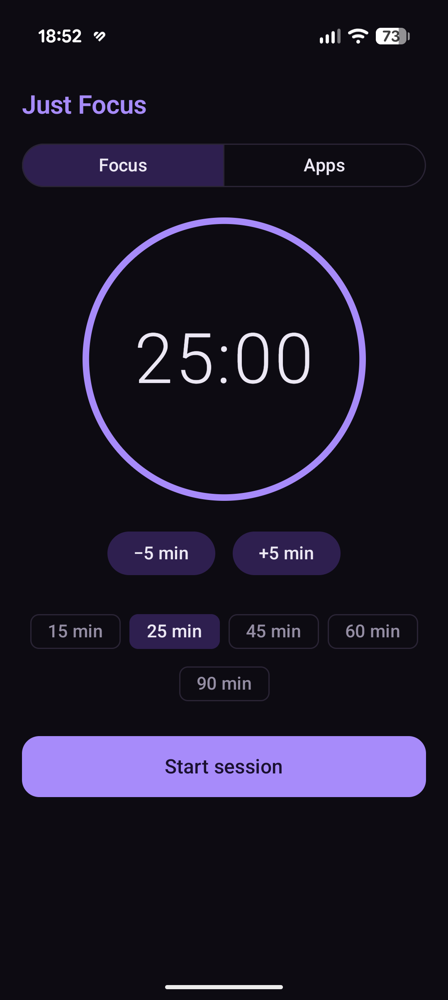
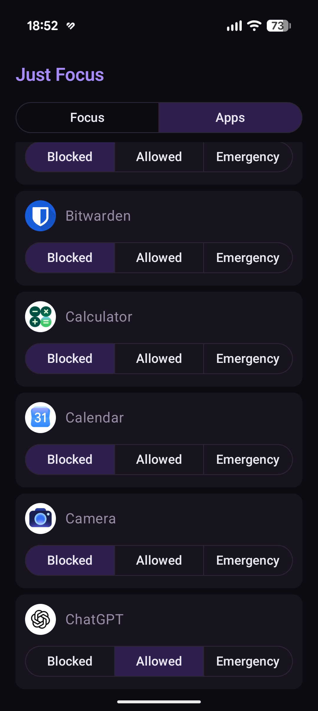

# Just Focus

A minimalist Android app that helps you focus on studying. Dark theme with purple accents.

<p align="center">
  
  &nbsp;&nbsp;
  
</p>

## Download

Every push to `main` publishes a new release. Open the **[latest release](../../releases/latest)**, download `just-focus-<version>.apk` on your phone and open it to install. New releases install over the old one as updates.

## Features

- **Session timer.** Pick a length from 5 to 240 minutes (±5 min buttons or presets), then *Start session* / *End session*.
- **App blocking.** During a session only your chosen apps work. Opening any other app brings you back to Just Focus. Allowed apps can also be launched straight from the session screen.
- **Notification filter.** During a session only *emergency* apps can notify you. Notifications from other apps are snoozed until the session ends, so nothing is lost.
- **"Focus session complete" notification** when the time is up.

Each app has one of three modes (the *Apps* tab):

| Mode      | Can be opened | Notifications     |
|-----------|---------------|-------------------|
| Blocked   | no            | after the session |
| Allowed   | yes           | after the session |
| Emergency | yes           | right away        |

The home screen, recent apps, phone calls (including emergency numbers), the keyboard and the system bars always work. You can leave Just Focus and use your phone freely – only opening a blocked app brings you back.

## Requirements

- Android 8.0 (API 26) or newer. Target SDK is 36.
- Permissions the app asks for on its main screen:
  - **Accessibility** (required): detects which app is in the foreground. It does not read screen content.
  - **Notification access** (required): snoozes notifications.
  - **Notifications** (recommended): shows the countdown and tells you when the session ends.
  - **Alarms & reminders** (recommended): ends the session on time even with the screen off.

> On Android 13+, apps installed from outside Google Play may have the Accessibility option greyed out.
> To enable it, go to *Settings → Apps → Just Focus → ⋮ → Allow restricted settings*.

## Building

```bash
./gradlew testDebugUnitTest   # unit tests
./gradlew assembleRelease     # APK: app/build/outputs/apk/release/app-release.apk
```

You need JDK 17+ (CI uses 21) and the Android SDK with platform 37.

The GitHub Actions workflow (`.github/workflows/android.yml`) runs the tests and builds the APK on every push and pull request. On every push to `main` it also creates a GitHub release `v1.0.<build number>` with the APK attached.

## Code structure

```
app/src/main/java/app/justfocus/
├── session/        Focus session: state, timer, storage, end-of-session alarm
├── apps/           App modes (blocked/allowed/emergency) and the rules built on them
├── blocking/       System services: app blocker, notification filter, FocusGuard
├── notifications/  "Session in progress" and "session complete" notifications
├── permissions/    Permission checks and links to system settings
├── ui/             Jetpack Compose screens (Focus, Apps) and theme
└── AppContainer.kt Simple manual dependency injection
```

The decision-making logic lives in plain Kotlin classes with no Android dependencies (`FocusSessionManager`, `FocusRules`, `FocusGuard`). That lets the unit tests run on the JVM without an emulator.

The launcher icon is generated from `logo/logo.png`.

## Known limitations

- Android plays a notification's sound before the app can snooze it. The notification disappears right away, but a short sound or vibration from a blocked app may still come through. Keeping the phone on vibrate while studying helps.
- Ongoing notifications (music, navigation, active calls) cannot be snoozed.
